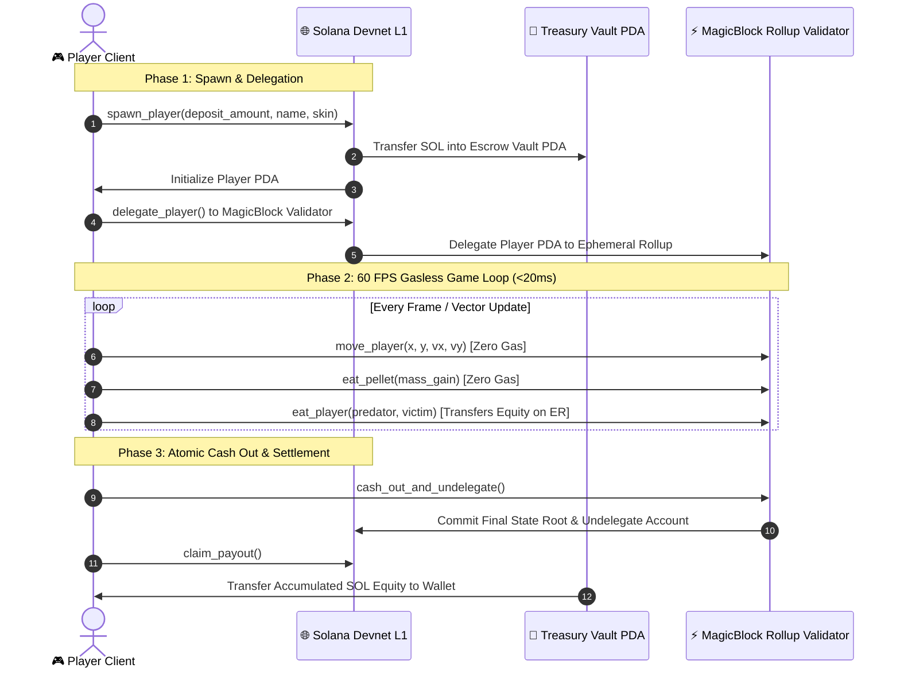

# 🟢 NomNom (Agar.sol) — Real-Time Ephemeral Rollup Bio-Fluid Arena on Solana

<p align="center">
  
</p>

<p align="center">
  <a href="https://github.com/sandman-sh/agar-sol"></a>
  <a href="https://solana.com/"></a>
  <a href="https://magicblock.gg/"></a>
  <a href="https://rust-lang.org/"></a>
  <a href="https://react.dev/"></a>
  <a href="https://vite.dev/"></a>
  <a href="https://supabase.com/"></a>
  <a href="#"></a>
</p>

---

## 📑 Table of Contents

- [⚡ Executive Overview](#-executive-overview)
- [✨ Core Innovations & Game Systems](#-core-innovations--game-systems)
  - [1. Real SOL Equity in Cell Mass](#1-real-sol-equity-in-cell-mass)
  - [2. Sub-20ms Ephemeral Rollup Game Loop](#2-sub-20ms-ephemeral-rollup-game-loop)
  - [3. Biological Entity Mechanics & Physics](#3-biological-entity-mechanics--physics)
  - [4. Custom Skins Collection](#4-custom-skins-collection)
  - [5. Atomic Extraction Zones](#5-atomic-extraction-zones)
  - [6. Procedural Web Audio Engine](#6-procedural-web-audio-engine)
  - [7. Mobile First Touch Controls](#7-mobile-first-touch-controls)
- [🛠️ System Architecture & Ephemeral Rollup Flow](#️-system-architecture--ephemeral-rollup-flow)
- [📜 Smart Contract Architecture (`nomnom`)](#-smart-contract-architecture-nomnom)
  - [On-Chain Addresses & Deployment Config](#on-chain-addresses--deployment-config)
  - [Core Program Instructions](#core-program-instructions)
  - [Account Models](#account-models)
  - [Custom Program Errors](#custom-program-errors)
- [🌐 Real-Time Multiplayer Protocol](#-real-time-multiplayer-protocol)
- [🎮 Game Controls & Hotkeys](#-game-controls--hotkeys)
- [🚀 Local Development & Setup Guide](#-local-development--setup-guide)
  - [Prerequisites](#prerequisites)
  - [1. Frontend Setup](#1-frontend-setup)
  - [2. Arena Initialization Script](#2-arena-initialization-script)
  - [3. Anchor Program Recompilation (Optional)](#3-anchor-program-recompilation-optional)
- [🛡️ Security, PDA Escrow & Anti-Cheat Invariants](#️-security-pda-escrow--anti-cheat-invariants)
- [📄 License & Credits](#-license--credits)

---

## ⚡ Executive Overview

**NomNom (Agar.sol)** is a high-performance, real-time multiplayer bio-fluid cell arena built for the Solana Virtual Machine (SVM). Leveraging **MagicBlock Ephemeral Rollups (ER)**, NomNom solves the fundamental blockchain gaming trilemma:
1. **Sub-20ms Latency**: Bypasses the 400ms Solana slot time to deliver responsive 60 FPS competitive arcade physics.
2. **Zero Gas Streaming**: Player movements, pellet feeding, and collision loops stream directly to the rollup validator without signing popups or micro gas charges.
3. **Atomic Base Layer Settlement**: Funds deposited in Solana L1 are locked into program-derived escrow vaults and settled atomically when players escape through Extraction Vortexes.

Players can jump into the arena instantly as **Guests** with zero setup, or connect a Solana wallet (**Phantom**, **Solflare**, **Backpack**) on **Devnet** to stake real SOL equity into their biological cell.

---

## ✨ Core Innovations & Game Systems

### 1. Real SOL Equity in Cell Mass

In NomNom, mass is not an arbitrary counter—it directly reflects on-chain equity:
$$\text{Spawn Mass} = \text{BASE\\_MASS} (20) + \left(\frac{\text{Deposited Lamports}}{50,000}\right)$$

| Stake Tier | SOL Deposit | Initial Mass | Strategic Role |
| :--- | :--- | :--- | :--- |
| **Guest Practice** | `0.000 SOL` | 20 Mass | Fast, stealthy, nimble for high-score training |
| **Micro Scout** | `0.005 SOL` | 120 Mass | Agile predator, hunting solitary cells |
| **Standard Nomad** | `0.010 SOL` | 220 Mass | Balanced bulk with tactical splitting capability |
| **Titan Cell** | `0.050 SOL` | 1,020 Mass | Dominates the central arena rifts |
| **Apex Leviathan**| `0.100 SOL` | 2,020 Mass | Server boss cell; high bounty target for splits |

When you absorb an opponent blob in the arena, you absorb **their cell mass and their deposited SOL equity in real-time**!

---

### 2. Sub-20ms Ephemeral Rollup Game Loop

Conventional on-chain games force turn-based rounds or clumsy tick updates due to L1 consensus times. NomNom utilizes MagicBlock's delegated PDA state model:
- The player creates and funds a `Player PDA` on Solana L1.
- The `Player PDA` is delegated to MagicBlock's Ephemeral Rollup validator (`MAS1Dt9qreoRMQ14YQuhg8UTZMMzDdKhmkZMECCzk57`).
- Player vector coordinates, pellet consumption, and combat collisions execute within the validator memory ring at sub-20ms frequency.
- The state can be committed periodically or settled on-demand.

---

### 3. Biological Entity Mechanics & Physics

- **Cell Mass & Radius Formula**: Cell radius grows logarithmically relative to mass: $R = \sqrt{\text{Mass}} \times 9$.
- **Speed Degradation**: Larger cells become heavier and slower:
  $$\text{Velocity Multiplier} = 2.2 \times \text{Mass}^{-0.439}$$
- **1,800 Food Pellets**: Scatter across the 4,500 × 4,500 map. Eating pellets yields +1 mass and accelerates growth.
- **18 Spiked Green Viruses**: Massive spiked obstacles (Radius = 72, Mass = 100).
  - Cells smaller than the virus can hide underneath for refuge.
  - Cells larger than the virus explode into up to 16 small sub-cells upon contact!
- **Spacebar Splitting**: Propels half of your cell's mass forward at 2.5x ejection velocity, allowing you to catch fast-moving prey.
- **W Ejection**: Fires 12-mass bait pellets forward to lure opponents, feed viruses, or feed team allies.
- **Recombination Cooldown**: Split sub-cells automatically merge back into a single unified cell after 15–30 seconds based on mass.

---

### 4. Custom Skins Collection

Players can express their identity using 8 handcrafted SVG procedural bio-skins:

| Skin ID | Name | Emblem | Fill Accent | Lore & Personality |
| :--- | :--- | :---: | :--- | :--- |
| `solana` | **Solana** | ◎ | `#14F195` (Neon Mint) | Pure high-speed SVM flow and liquidity |
| `wizardio` | **Wizardio** | 🧙 | `#9945FF` (Purple Arcane)| MagicBlock Architect & Rollup Sorcerer |
| `bonk` | **Bonk** | 🐕 | `#F89E2B` (Golden Bonk) | The community bat doge hunting paper hands |
| `pepe` | **Pepe** | 🐸 | `#589E39` (Frog Green) | Feels good man; the eternal meme survivor |
| `phantom` | **Phantom** | 👻 | `#7C67FE` (Spectral Indigo)| Elusive stealth wallet maneuvering in shadows |
| `doge` | **Doge** | 🐶 | `#D8A72B` (Shiba Amber) | Much split. Very eat. Wow. |
| `monke` | **Monke** | 👑 | `#FF5E7E` (Solana Royalty) | Royal SMB Crown bearer commanding the grid |
| `chad` | **GigaChad** | 🗿 | `#22D3EE` (Cyber Cyan) | Absolute peak rollup performance |

---

### 5. Atomic Extraction Zones

To prevent spawn camping and lock in earned profits, 5 extraction rifts are situated across the 4,500 × 4,500 arena:

```
[Northwest Extraction]                     [Northeast Extraction]
  (x: 500, y: 500)                            (x: 4000, y: 500)
             \                                    /
              \                                  /
               --->   [Central Rollup Rift]  <---
                        (x: 2250, y: 2250)
              /                                  \
             /                                    \
[Southwest Extraction]                     [Southeast Extraction]
  (x: 500, y: 4000)                           (x: 4000, y: 4000)
```

- When a player steers inside an extraction circle, the **E** prompt or on-screen button lights up.
- Initiating extraction calls `cash_out_and_undelegate` on the Ephemeral Rollup.
- State is committed to Solana L1, and `claim_payout` unlocks the accumulated SOL prize directly to the player's wallet.

---

### 6. Procedural Web Audio Engine

NomNom features an ultra-responsive, zero-asset Web Audio API procedural synthesizer (`audio.ts`):
- **Pentatonic Munch Arpeggios**: Consecutive pellet consumption triggers an accelerating musical pitch ladder (sine wave frequencies ramping from 440 Hz up to 880 Hz).
- **Virus Pop Burst**: White noise buffer burst combined with a low-frequency oscillator crunch (80 Hz exponential plunge).
- **Split Swoosh**: High-pass filtered frequency sweep simulating aerated velocity ejection.
- **Cash Out Fanfare**: Polyphonic 4-chord triumphant harmonic resolution.
- **Death Dissolve**: Sub-bass crunch and noise dissipation.

---

### 7. Mobile First Touch Controls

The interface is engineered with a responsive dual-stick touch layout (`TouchControls.tsx`):
- **Dynamic Floating Joystick**: Automatically appears wherever your left thumb touches the display.
- **Action Buttons**: Ergonomic bottom-right touch triggers for **SPLIT** (Space) and **FEED** (W).
- **Extraction HUD**: One-tap cash out button appears when hovering over any of the 5 extraction rifts.
- **Orientation Prompt**: Smart landscape rotation banner on mobile devices for peak FOV.

---

## 🛠️ System Architecture & Ephemeral Rollup Flow



---

## 📜 Smart Contract Architecture (`nomnom`)

The on-chain program is written in **Anchor / Rust** and implements MagicBlock's `ephemeral-rollups-sdk`.

### On-Chain Addresses & Deployment Config

| Resource | Identity / Public Key | Explorer Link |
| :--- | :--- | :--- |
| **Program ID** | `7VDmuJyPxyKA9rzqoupukyLZJXGgbvzZpZPTb3AGFTNi` | [Solana Explorer](https://explorer.solana.com/address/7VDmuJyPxyKA9rzqoupukyLZJXGgbvzZpZPTb3AGFTNi?cluster=devnet) |
| **Arena PDA** | `JBJqW1nbZUZFwB7zVtpWosY8CGAUVYC75tnmURDxAtnW` | [Solana Explorer](https://explorer.solana.com/address/JBJqW1nbZUZFwB7zVtpWosY8CGAUVYC75tnmURDxAtnW?cluster=devnet) |
| **Vault PDA** | `7GC6fvQT159yfRydKWS6StYBVXoYTvaUaygS2c36xLV9` | [Solana Explorer](https://explorer.solana.com/address/7GC6fvQT159yfRydKWS6StYBVXoYTvaUaygS2c36xLV9?cluster=devnet) |
| **Base RPC** | `https://api.devnet.solana.com` | Solana Devnet |
| **MagicBlock ER RPC** | `https://devnet.magicblock.app/` | MagicBlock Rollup RPC |
| **MagicBlock ER WS** | `wss://devnet.magicblock.app/` | MagicBlock Rollup WebSocket |
| **Validator Pubkey**| `MAS1Dt9qreoRMQ14YQuhg8UTZMMzDdKhmkZMECCzk57` | MagicBlock Ephemeral Validator |

---

### Core Program Instructions

| Instruction | Execution Layer | Description |
| :--- | :--- | :--- |
| `initialize_arena` | Solana L1 | Initializes global Arena PDA and creates the Treasury Vault PDA. |
| `spawn_player` | Solana L1 | Deposits initial SOL equity into the Vault and seeds the Player PDA. |
| `delegate_player` | Solana L1 | Delegates the Player PDA to MagicBlock's validator for zero-gas ER execution. |
| `move_player` | Ephemeral Rollup | Updates player vector and coordinates at sub-20ms latency. |
| `eat_pellet` | Ephemeral Rollup | Consumes food pellets, increasing blob mass and live score. |
| `eat_player` | Ephemeral Rollup | Combat resolution: predator absorbs prey's mass and steals their lamport equity. |
| `commit_player` | Ephemeral Rollup | Checkpoints state to Solana base layer without undelegating. |
| `cash_out_and_undelegate` | Ephemeral Rollup | Commits final state and undelegates the account back to Solana L1. |
| `claim_payout` | Solana L1 | Transfers accumulated SOL from the Vault PDA to the player's wallet. |

---

### Account Models

#### 1. Arena PDA (`seeds = [b"arena"]`)
```rust
pub struct Arena {
    pub admin: Pubkey,          // Admin authority who initialized
    pub vault: Pubkey,          // Treasury Vault PDA holding deposited funds
    pub total_players: u32,     // Lifetime spawned player count
    pub min_deposit: u64,       // Minimum stake in lamports (e.g. 5,000,000 = 0.005 SOL)
    pub vault_bump: u8,         // Bump seed for Vault PDA
    pub bump: u8,               // Bump seed for Arena PDA
}
```

#### 2. Player PDA (`seeds = [b"player", player_signer.key()]`)
```rust
pub struct Player {
    pub authority: Pubkey,       // Wallet owner of this blob
    pub arena: Pubkey,           // Parent Arena PDA
    pub name: [u8; 16],          // UTF-8 player handle
    pub x: i32,                  // X position in the 4,500x4,500 grid
    pub y: i32,                  // Y position in the 4,500x4,500 grid
    pub vx: i16,                 // Instantaneous X velocity
    pub vy: i16,                 // Instantaneous Y velocity
    pub mass: u64,               // Total biological mass
    pub score: u64,              // Accumulated lifetime score
    pub kills: u32,              // Confirmed player blob eliminations
    pub color: u8,               // Color / Skin ID index
    pub is_alive: bool,          // Live status flag
    pub deposit_lamports: u64,   // Live SOL equity held in this cell
    pub bump: u8,                // Bump seed for Player PDA
}
```

---

### Custom Program Errors

```rust
pub enum NomNomError {
    DepositTooLow,               // Minimum arena deposit threshold not met
    PlayerEliminated,            // Action attempted on an already dead blob
    VictimAlreadyDead,           // Cannot eat an inactive player
    InsufficientMassAdvantage,   // Predator must possess at least 10% greater mass
    NotInEatingRange,            // Cell distance exceeds collision boundary
    NoBalanceToClaim,            // No accumulated lamports to claim from vault
}
```

---

## 🌐 Real-Time Multiplayer Protocol

NomNom combines on-chain Ephemeral Rollup settlement with a high-throughput **Supabase Realtime** peer-relay channel (`supabase.ts`):
1. **Room Generation**: Players can create and join unique instances with cryptographically unguessable room codes (`generateUnguessableRoomId()`).
2. **State Broadcasts**: Broadcasts 20Hz vector packets containing cell arrays, split pieces, skins, and kill feeds.
3. **Local BroadcastChannel Fallback**: Supports zero-latency tab-to-tab testing within the same browser instance.
4. **Hermite / Linear Interpolation**: Smooths remote entity trajectories across frame renders to eliminate jitter.

---

## 🎮 Game Controls & Hotkeys

| Action | Desktop Controls | Mobile / Touch Controls |
| :--- | :--- | :--- |
| **Move Blob** | Mouse cursor direction | Dynamic floating thumb joystick |
| **Split Cell** | <kbd>Space</kbd> | On-screen **SPLIT** button |
| **Eject Mass** | <kbd>W</kbd> | On-screen **FEED** button |
| **Cash Out** | <kbd>E</kbd> (Inside Extraction Zone) | On-screen **CASH OUT** banner |
| **Game Menu** | <kbd>Escape</kbd> | Floating gear icon |

---

## 🚀 Local Development & Setup Guide

### Prerequisites
- [Node.js 18+](https://nodejs.org/) & `npm`
- [Rust & Cargo](https://rustup.rs/) (for Anchor smart contract work)
- [Solana CLI 1.18+](https://docs.solana.com/cli/install-solana-cli-tools)
- [Anchor CLI 0.32+](https://www.anchor-lang.com/)
- A Solana browser wallet (Phantom, Solflare, or Backpack) switched to **Devnet**.

---

### 1. Clone Repository & Setup Frontend

```bash
# Clone the repository
git clone https://github.com/sandman-sh/agar-sol.git
cd agar-sol

# Navigate to the frontend directory
cd app

# Install dependencies
npm install

# Start the high-speed Vite dev server
npm run dev
```

Open **`http://localhost:5173/`** in your browser.

#### Production Build
```bash
npm run build
npm run preview
```

---

### 2. Arena Initialization Script

To initialize or verify the on-chain arena account with a custom minimum deposit:

```bash
cd app
node scripts/init_arena.mjs
```

The script automatically derives the Arena and Vault PDAs and executes `initialize_arena` with a default 0.005 SOL minimum stake.

---

### 3. Anchor Program Recompilation (Optional)

```bash
# Build the Solana program
anchor build

# Deploy to Solana Devnet
anchor deploy --provider.cluster devnet
```

---

## 🛡️ Security, PDA Escrow & Anti-Cheat Invariants

- **Non-Custodial Escrow**: All staked SOL flows directly into the program-derived `Vault PDA` signed deterministically by the Arena seed bump. No external entity or admin key has unilateral withdrawal permission.
- **Physical Collision Invariant**: The `eat_player` instruction mathematically verifies that predator mass exceeds victim mass by at least 10% ($M_{\text{predator}} > 1.1 \times M_{\text{victim}}$) and checks coordinate bounding radii on-chain before lamport equity transfers.
- **Rollup Cryptographic State Roots**: MagicBlock's Ephemeral Rollup validator signs and commits state roots back to Solana Base Layer before undelegation and `claim_payout` execution.
- **Anti-Drain Guarantee**: Players who play as Guests cannot call `claim_payout` or drain the escrow vault. `deposit_lamports` is strictly checked against the recorded on-chain ledger.

---

## 📄 License & Credits

Built with ❤️ for the Solana and MagicBlock ecosystems.

- **Game Engine**: Custom HTML5 Canvas 60 FPS Bio-Fluid Renderer
- **Rollup Engine**: [MagicBlock Ephemeral Rollups](https://magicblock.gg/)
- **Smart Contract**: [Anchor Framework](https://www.anchor-lang.com/) & [Solana](https://solana.com/)
- **Audio Synthesis**: Native Web Audio API Procedural Synth
